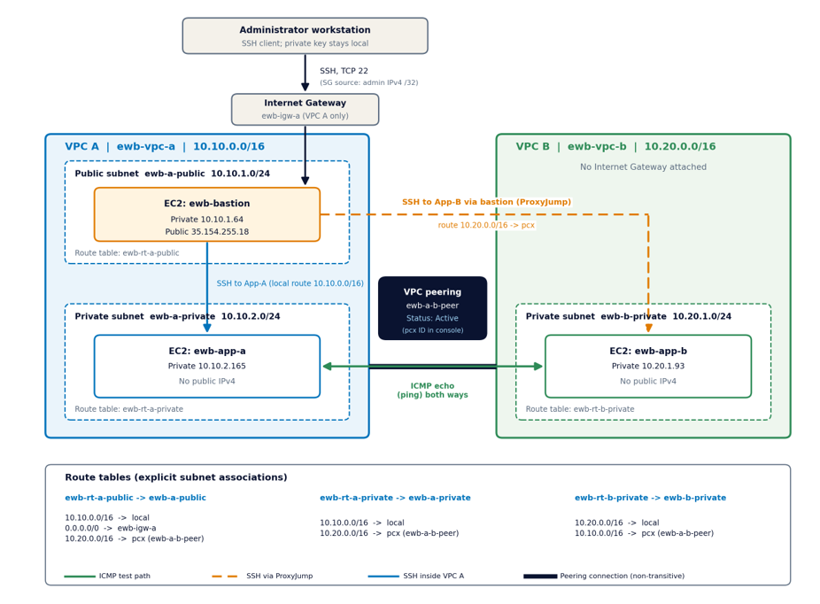

# AWS VPC Peering: Cross-VPC Private Connectivity

## Project Overview

This project demonstrates how to establish private network communication between two Amazon Virtual Private Clouds (VPCs) using AWS VPC Peering.

The lab uses two VPCs with non-overlapping CIDR blocks, private application instances, route tables, security groups, and a bastion host for SSH access.


## Network Architecture

The following diagram illustrates the AWS VPC Peering setup, including the two VPCs, subnets, routing, and private connectivity.




## Objectives

- Create and configure two independent VPCs.
- Establish and activate a VPC peering connection.
- Configure routes for communication between the VPCs.
- Apply security-group rules to control network traffic.
- Access private EC2 instances through a bastion host.
- Test connectivity in both directions.
- Verify how security-group rules affect connectivity.

## Architecture

```text
                    SSH from Administrator
                              |
                              v
                    +-------------------+
                    |   Bastion Host    |
                    | Public Subnet A   |
                    +-------------------+
                              |
                    Private SSH access
                              |
             +----------------------------+
             |            VPC A           |
             |         10.10.0.0/16       |
             |                            |
             |  Private Subnet            |
             |  10.10.2.0/24              |
             |  +----------------------+  |
             |  | Application EC2 A    |  |
             |  | 10.10.2.165          |  |
             |  +----------------------+  |
             +-------------+--------------+
                           |
                  VPC Peering Connection
                           |
             +-------------+--------------+
             |            VPC B           |
             |         10.20.0.0/16       |
             |                            |
             |  Private Subnet            |
             |  10.20.1.0/24              |
             |  +----------------------+  |
             |  | Application EC2 B    |  |
             |  | 10.20.1.93           |  |
             |  +----------------------+  |
             +----------------------------+

## Network Configuration

| Component | Configuration |
|---|---|
| AWS Region | Asia Pacific (Mumbai), ap-south-1 |
| VPC A | 10.10.0.0/16 |
| VPC B | 10.20.0.0/16 |
| VPC A private subnet | 10.10.2.0/24 |
| VPC B private subnet | 10.20.1.0/24 |
| Peering | Active during testing |
| Compute | Amazon EC2, t3.micro instances |
| Operating system | Amazon Linux 2023 |
| Administration | SSH through a bastion host |

## Routing

Both VPCs have routes for their local networks. Additional routes direct traffic destined for the peer VPC through the VPC peering connection.

- VPC A route tables include a route to `10.20.0.0/16` through the peering connection.
- VPC B private route table includes a route to `10.10.0.0/16` through the peering connection.

VPC peering does not automatically configure routes or security rules. Both sides must be configured appropriately.

## Security

- The bastion host accepts SSH from an authorized administrator IP.
- Private application instances accept SSH from the bastion host.
- ICMP echo-request rules allow the intended application instances to test connectivity.
- Private application instances do not require public IP addresses for communication across the peering connection.
- The SSH private key remains local and must never be committed to the repository.

## Testing and Results

### 1. VPC Peering Status
The peering connection was verified as Active.

### 2. Connectivity from VPC A to VPC B
A ping test from Application EC2 A to Application EC2 B completed successfully, with four packets received and zero packet loss.

### 3. Connectivity from VPC B to VPC A
A reverse ping test also completed successfully, with four packets received and zero packet loss.

### 4. Security-Group Failure and Recovery
During a controlled test, the relevant ICMP inbound rule was removed. The ping test failed. After the rule was restored, connectivity recovered.

This demonstrates that routing alone is not sufficient: security-group rules must also permit the required traffic.

## Evidence

The `evidence/` directory contains screenshots collected during the lab. Review each screenshot before publishing the repository to ensure that it does not reveal sensitive account information or infrastructure details you do not wish to share.

## Key Learnings

- VPCs provide logically isolated virtual networks.
- VPC peering enables private IP connectivity between two VPCs.
- CIDR blocks must not overlap for a standard VPC peering connection.
- Routes determine where network traffic is sent.
- Security groups control permitted inbound and outbound traffic.
- A bastion host provides a controlled administrative entry point to private instances.
- Connectivity testing helps distinguish routing problems from security-rule problems.

## Cleanup

After saving the final report and verifying the repository, terminate the lab EC2 instances and remove unused lab resources to avoid ongoing charges. Verify the AWS billing dashboard and applicable free-tier or credit terms rather than assuming every resource is free.

## Disclaimer

This is an educational lab project. Resource identifiers and environment-specific details should be reviewed before public release. No private keys, passwords, or AWS access credentials should be included.

